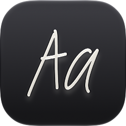
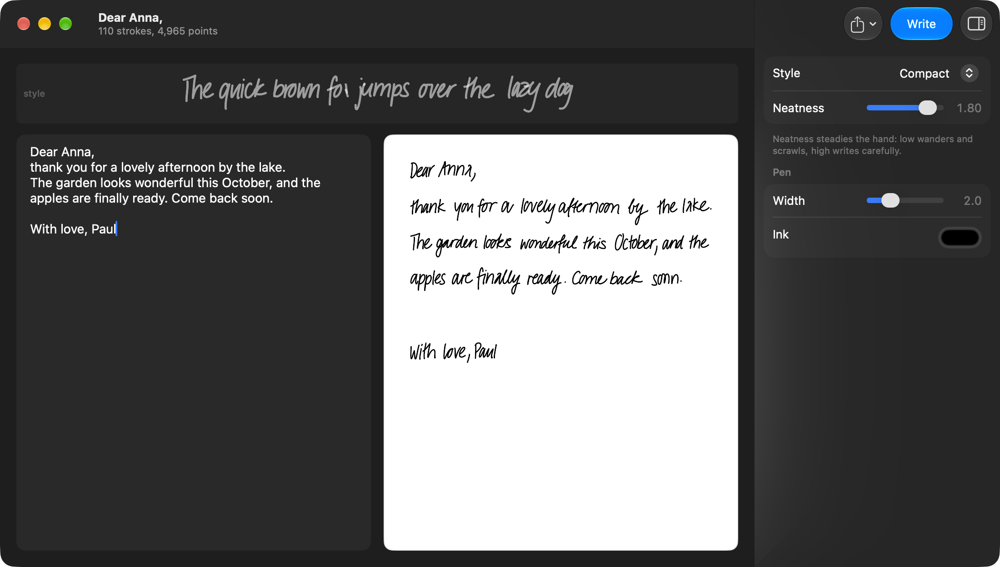
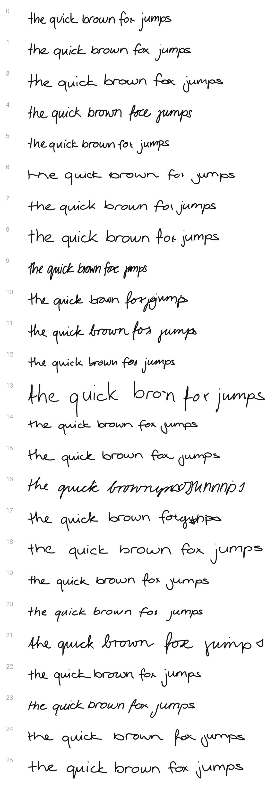

<p align="center">
  
</p>

<h1 align="center">Handwriting</h1>

<p align="center">
  A native macOS app that writes what you type in a human hand, and saves it as PNG or SVG.<br>
  The <a href="https://github.com/sjvasquez/handwriting-synthesis">handwriting synthesis</a> network, ported to Swift.
</p>

<p align="center">
  
</p>

This is a fork of [sjvasquez/handwriting-synthesis](https://github.com/sjvasquez/handwriting-synthesis),
an implementation of the handwriting synthesis experiments in
[Generating Sequences with Recurrent Neural Networks](https://arxiv.org/abs/1308.0850)
by Alex Graves. The model and its pretrained weights are unchanged. What is new
is everything around them: the network was lifted off TensorFlow onto numpy,
then onto Swift, so it fits in a double-clickable app. No terminal, no Python,
no TensorFlow - an 18 MB app that opens instantly and works offline.

## Features

- **Two pages side by side**: what you type on the left, what it becomes on the
  right, written from the top of the sheet the way a letter would be. Lines
  longer than 75 characters wrap on word boundaries, blank lines become blank
  lines.
- **Write** (⌘↩, in the toolbar and the File menu) writes the text; while it
  writes, the same button reads **Stop**. A line takes about a second.
- **24 named hands**: **Style**, in the inspector, picks one - Notebook,
  Copperplate, Spidery and so on. The strip above the pages shows that hand
  writing the same sentence as every other, so the styles can be compared -
  generated ahead of time and shipped with the app, because writing it takes
  about a second and nobody wants to wait while flipping through styles.
- **Neatness** steadies the hand. It is the network's sampling bias: at 0.3 the
  writing wanders and scrawls, at 2.0 it writes carefully. It starts at 1.8,
  careful but still plainly handwritten.
- **Width** sets the pen's stroke, and **Ink** its colour.
- **Export as PNG…** (⌘E) or **Export as SVG…** (⇧⌘E), from the File menu or
  the Export button in the toolbar. Both are saved with a transparent
  background, so handwriting drops straight onto a document, and the SVG scales
  forever and opens in Illustrator or Figma. The preview draws through the same
  code that writes the file, so what is on screen is what gets saved.
- **Inspector**: the hand and the pen live in a panel on the right, which
  View → Hide Inspector (⌃⌘I) or the toolbar button puts away.
- **Any text**: accented letters, typographic quotes and a few symbols are
  mapped onto what the network knows (see Known limitations), and anything it
  cannot write is listed under the text box instead of being silently dropped.
- **Command line**: the same binary writes a page or checks itself without a
  window (see Installation).

Every hand, writing the sentence the style strip shows:



## Requirements

- To run it: a Mac with Apple Silicon and macOS 13 or later. On macOS 26 and
  later the window has the Liquid Glass look; earlier systems draw the same
  window more plainly, and on macOS 13 the inspector is a fixed pane.
- To build it: Xcode 26 or later (the app uses the macOS 26 SDK, and falls back
  on older systems at run time), and [uv](https://docs.astral.sh/uv/) for the
  one Python step that packs the model and the styles into the files the app
  reads:

  ```bash
  brew install uv
  ```

- TensorFlow only to regenerate `hw/weights.npz` from the original checkpoint,
  which is never needed for building: the weights are committed.

## Installation

No prebuilt app is published: build it from source.

```bash
git clone https://github.com/giuliomaffei90/handwriting-synthesis-mac-ui.git
cd handwriting-synthesis-mac-ui
./tools/build_app.sh          # -> dist/Handwriting.app
open dist/Handwriting.app
./tools/make_dmg.sh           # -> dist/Handwriting-<version>.dmg, optional
```

`tools/build_app.sh` packs `hw/weights.npz`, `hw/previews.npz` and the styles
into `swift/Resources/*.bin` with `tools/make_swift_resources.py`, in a `.venv`
it creates with uv (Python 3.12, numpy and pillow) and only when the sources
changed. It then builds the Swift package in release, recording the real SDK in
the binary - `swift build` would otherwise record the macOS 13 deployment
target as the SDK, and macOS would draw the app with the old look. It assembles
the bundle, compiles the icon with `actool`, writes the Info.plist (version
2.0.3 unless `VERSION` is set), signs it ad hoc - Apple Silicon will not run an
unsigned binary - and finally runs the app's self-test, so a bundle that fails
it is never left behind. `tools/make_dmg.sh` wraps the app in a disk image with
an alias to Applications and checks that the image mounts and runs.
`tools/build_dev_mac.sh` builds, drops the app in ~/Downloads and relaunches it.

For development, once `build_app.sh` has packed the resources, the package runs
straight from `swift/`:

```bash
swift run --package-path swift Handwriting
```

The app is also a small command line tool, which is how it gets checked without
clicking through it:

```bash
dist/Handwriting.app/Contents/MacOS/Handwriting --selftest
dist/Handwriting.app/Contents/MacOS/Handwriting --write "hello there" --style 9 --out page
```

`--write` also takes `--bias` (the neatness, 1.0 by default) and `--seed`, and
writes `page.svg` and `page.png`. For the numpy side:

```bash
uv venv --python 3.12 .venv
VIRTUAL_ENV=.venv uv pip install numpy pillow
.venv/bin/python tests/test_engine.py
```

Regenerating `hw/weights.npz` from `checkpoints/` needs TensorFlow -
`uv pip install "tensorflow>=2.16"`, then `python tools/tf_export.py`. The app
icon is an Icon Composer document, `assets/AppIcon.icon`, which macOS 26
renders as Liquid Glass, with its dark and tinted appearances - earlier systems
show it flat. It began as the model's own "Aa", laid down by
`tools/make_icon.py`, and has since been refined by hand in Icon Composer -
which is where to edit it now. The tool refuses to overwrite the document unless
given `--force`. `tools/make_samples.py` builds the style sheet above.

## How it works

1. **The text is mapped onto the alphabet.** [`Text.swift`](swift/Sources/Handwriting/Text.swift)
   turns what was typed into the 73 characters the network knows and wraps it
   into lines of at most 75; [`Composer.swift`](swift/Sources/Handwriting/Composer.swift)
   runs the job off the main thread and reports progress to the toolbar.
2. **Each line is written in pieces.** [`Generator.swift`](swift/Sources/Handwriting/Generator.swift)
   splits a line into pieces of up to 38 characters on word boundaries, primes
   the network with the chosen style - its sample line from
   [`Styles.swift`](swift/Sources/Handwriting/Styles.swift), fed through the
   network as if it had written it - and writes each piece, again if it went
   wrong.
3. **The network samples pen movements.** [`Engine.swift`](swift/Sources/Handwriting/Engine.swift)
   runs three 400-unit LSTMs, the Gaussian attention window over the characters
   and the 20-component mixture density output, with matrix products through
   Accelerate, and stops when the attention has read past the last character.
4. **The pieces become a page.** [`Drawing.swift`](swift/Sources/Handwriting/Drawing.swift)
   straightens each piece, joins the pieces on one baseline, smooths the strokes
   and lays the lines down on a page.
5. **The page is drawn and saved.** The preview in
   [`ContentView.swift`](swift/Sources/Handwriting/ContentView.swift) and
   [`Export.swift`](swift/Sources/Handwriting/Export.swift), which writes the
   SVG and the PNG, stroke the same paths.

**Off TensorFlow.** The original needs TensorFlow 1.6, which has no Apple
Silicon build, so the model was moved off it entirely, in two steps.
`tools/tf_export.py` loads the frozen meta graph with TF2's `compat.v1` API - no
`tf.contrib`, no Python 2, no Rosetta - and dumps the ten weight tensors the
model actually uses into `hw/weights.npz`: 14 MB, down from a 43 MB checkpoint
that was mostly optimizer state. `hw/engine.py` then re-implements inference in
numpy: three 400-unit LSTMs, the Gaussian attention window over the character
sequence, and the 20-component mixture density output that gets sampled into
pen movements. `hw/drawing.py` drops scipy, because the Savitzky-Golay smoother
the original imports is a fixed 7-tap kernel.

**Off Python.** `swift/` is the app: the same network again in Swift, matrix
products through Accelerate, drawn and exported with Core Graphics. numpy stays
as the reference implementation - it is what the Swift port is checked against,
and what the tools use.

**Checked against the original.** Both ports are verified the same way, against
a trace captured from the original TensorFlow graph. After 738 recurrent steps
the mixture density parameters agree to `7.6e-05` in numpy and `1.75e-04` in
Swift, on values up to 25, and every state tensor to `1e-05`.
`tests/test_engine.py` checks the numpy side; `Handwriting --selftest` checks
the app, and the build refuses to ship a bundle that fails it. The sampling path
was checked separately by running numpy and TensorFlow at a bias high enough to
make sampling near-deterministic: same trajectory, identical pen-up flags on all
203 steps.

**Writing in pieces.** The corpus the model learnt from is made of short lines:
half of them are 29 characters or fewer, only one in fifty reaches 45, and not
one of the six thousand reaches 63. The 75-character limit in the original code
is the width its training arrays were padded to, not a length the model can
write. Ask for a line that long and it is being asked for something it has
never seen, which is where invented letters came from - they appeared part way
through and ran to the end of the line. So a line is written in pieces of 38
characters, split on word boundaries, and the pieces are joined back together.
Each is straightened on its own before being set down, which is what hides the
joins: their baselines end up on one line rather than wandering apart, and the
result reads as a single continuous line. Lines shorter than that are written
exactly as before. Asked to write a 63-character sentence in all 24 hands, the
model used to produce four lines of gibberish; written in pieces it produces
none.

**Knowing when to stop.** The model decides it has finished a line when the pen
happens to lift at the exact step its attention reaches the last character.
Styles that rarely lift the pen never hit that coincidence: the attention gets
stuck a few characters short and the model rewrites the last word until the
step budget runs out, which is where invented words come from. Two changes
catch it. The budget is no longer a flat 40 timesteps per character but 1.45
times the pace of the chosen style, measured from its own priming sample -
styles write at between 19 and 42 timesteps per character, so the old fixed
budget was generous for some and impossible for others. Over a hundred healthy
lines none needed more than 1.39 times their style's pace, while stuck ones ran
to 2.2, 3.8 and beyond, so the two separate cleanly. And a line that does not
finish inside that budget is written again, up to five times, keeping the
attempt that read furthest. A piece is also written off when the reading falls
back to characters it has already written, which is what losing the thread
looks like from the inside. Over lines judged by eye, the ones that came out
right never fell back by more than 2.9 characters while the failures went to 5,
7 and 12, so the limit is set at 3.

## Where the styles come from

A style is not a trained thing. There is one model, and a style is simply a
line of real handwriting shown to it before it starts writing - two files, the
pen movements and the text that was written. The model copies the hand it was
just shown.

The thirteen that ship with the original are nothing special: they are lines
0, 5, 8, 12, 19, 26, 28, 32, 37, 42, 44, 46 and 51 of the preprocessed IAM
On-Line Handwriting Database, the corpus the model was trained on - roughly
10,000 lines written by 221 people. So any other line of that corpus is a
style too, which is what `tools/extract_styles.py` is for.

**Styles 14 to 25** were mined that way. Picking lines at random does not work:
about four in ten send the model off the rails, and many of the rest are
indistinguishable from each other. So every candidate is screened by actually
writing with it - two sentences, four seeds each, all of which must finish
inside the step budget - and the survivors are then chosen by greedy
farthest-point selection over five measurements of the hand (its height, how
long it dwells per character, how often the pen leaves the paper, how curly it
is, and its slant), seeded with the styles already in the app so the new ones
differ from those too. Of 240 candidates, 100 wrote cleanly and 12 were kept.

The one new style contributed by any of the 609 forks of the original, from
[jonathanmaxberman's](https://github.com/jonathanmaxberman/handwriting-synthesis),
was tried here as style 13 and dropped again: a large round printed hand, but
one that cannot write a capital T.

Each style has a name, in `styles/names.json`, given by looking at what it
writes. The numbers stay too, since the readme and the corpus both speak in
them:

| | | | |
|---|---|---|---|
| 0 Notebook | 1 Everyday | 3 Rounded | 4 Hurried |
| 5 Tidy | 6 Airy | 7 Casual | 8 Generous |
| 9 Compact | 10 Schoolbook | 11 Flowing | 12 Plain |
| 14 Fine | 15 Breezy | 16 Copperplate | 17 Friendly |
| 18 Block | 19 Brisk | 20 Spidery | 21 Sweeping |
| 22 Steady | 23 Italic | 24 Open | 25 Careful |

`prepare_data.py` builds the corpus arrays from the raw IAM-OnDB download with
numpy alone, no TensorFlow; `tools/extract_styles.py` reads either those or the
`strokes-py3.npy` / `sentences.txt` pair that circulates in course
repositories, which is the same corpus already converted to stroke offsets.

To add your own handwriting instead, the recipe - independently arrived at by
three people in the upstream issues - is: record the pen positions, flip the y
axis, then `align`, `denoise`, `coords_to_offsets` and `normalize` from
`drawing.py`, cut to 1200 points, and save the offsets next to the text you
wrote.

## Known limitations

- The network only knows 73 characters, and none of them are accented. An
  accent becomes the plain letter and an apostrophe, the way it is typed on a
  machine that has none: `è` is written `e'`, `città` becomes `citta'`. Other
  marks have no such convention and are simply flattened, so `garçon` is
  written `garcon`. A few symbols are substituted (`&` becomes `and`), and
  uppercase `Q X Z` were never in the training set so they become lowercase.
- Now and then a word still comes out wrong, usually the last one before a
  join. Press Write again.
- Two hands were dropped for being broken rather than merely quirky. Style 2 of
  the original, asked to write the same sentence eight times, produced garbage
  eight times, always losing the thread near the end - not bad luck but a fault
  of the model, reported upstream as
  [issue 66](https://github.com/sjvasquez/handwriting-synthesis/issues/66) and
  reproducible on the author's own web demo. Style 13, contributed by a fork,
  could not form a capital T in any of thirteen attempts, because its priming
  sample never shows one. The numbering keeps both gaps, so every remaining
  style still answers to the number it has always had.
- Priming with your own handwriting steers the model rather than cloning your
  hand: it picks up size, slant and roundness, not your letterforms.
- Apple Silicon only, and the app is not notarized. Moving it while it is open
  leaves the running copy pointing at files that are gone: quit and reopen it.
- The training pipeline is untouched and still needs TensorFlow 1.x:
  `prepare_data.py` for the IAM-OnDB data, `rnn.py` to train, `demo.py` for the
  scripted examples. See the
  [upstream README](https://github.com/sjvasquez/handwriting-synthesis/blob/master/readme.md)
  and its [web demo](https://seanvasquez.com/handwriting-generation/).

## Legal note

Every style here is IAM-OnDB material, the same as the original thirteen. The
corpus is free for non-commercial research, and its keepers ask that users
register - which is where to get it:
[fki.tic.heia-fr.ch](https://fki.tic.heia-fr.ch/databases/iam-on-line-handwriting-database).

All credit for the model, the training and the pretrained weights goes to
[Sean Vasquez](https://github.com/sjvasquez).
